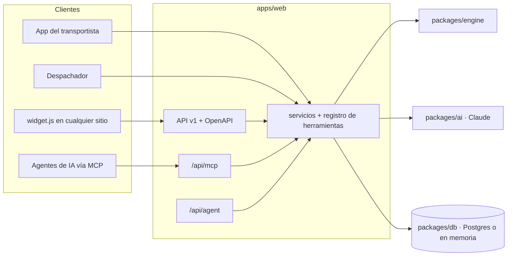

# Retorno · No regreses vacío

[English](README.md) · **Español**

Un copiloto de carga de regreso para el hombre-camión en México. Le dices dónde y cuándo descargas, qué unidad traes y
dónde está tu base, y te recomienda la mejor carga de regreso (o una cadena de dos). Te muestra cuánto ganas de más
frente a regresar vacío, te explica por qué en lenguaje de transportista y te deja listo un mensaje de WhatsApp.

> **Concepto no oficial por Neftalí Hernández. No afiliado a BeGo.** Todos los datos son sintéticos. Los costos por
> defecto (diésel, rendimiento, casetas) son supuestos configurables, no datos de mercado.


---

## Por qué

El regreso en vacío es el problema central de un marketplace de carga. El perfil de BeGo en YC dice que los camiones
ruedan vacíos cerca del 40% del tiempo y que BeGo usa machine learning para reducir los regresos en vacío. Retorno
explora ese problema de punta a punta: un motor de score, la experiencia del transportista, una vista de despachador y
dos formas de conectar el motor a un producto existente (un widget embebible y un servidor MCP para asistentes de IA).

## Qué incluye

| Superficie                               | Ruta                             | Para quién                                                                                                                                                     |
| ---------------------------------------- | -------------------------------- | -------------------------------------------------------------------------------------------------------------------------------------------------------------- |
| **App del transportista** (mobile-first) | `/` → `/cargas` → `/cargas/[id]` | Texto libre o voz → top 5 de cargas de regreso, cadenas de 2 cargas, detalle con mapa animado, cascada del dinero, explicación con IA y "Aceptar por WhatsApp" |
| **Vista de despachador**                 | `/despacho`                      | Flota en el mapa y "Simular semana": la misma flota y el mismo mercado con el comportamiento de hoy contra seguir las recomendaciones, con KPIs en vivo        |
| **Widget embebible**                     | `/embed` · `/widget.js`          | `<retorno-widget>`, un web component de 5 KB (gzip) que funciona en HTML, React o Angular                                                                      |
| **Agente de IA + servidor MCP**          | `/agent` · `/api/mcp`            | El motor como herramientas para un asistente de IA: un chat dentro de la app más un endpoint MCP estándar que cualquier agente puede usar                      |
| **API pública**                          | `/api/v1/*` · `/docs`            | API REST versionada con especificación OpenAPI 3.1, generada desde los mismos esquemas Zod que validan las peticiones                                          |

Semana simulada en el mercado sintético (25 camiones, 320 cargas, 7 días): los km en vacío bajan de **34.4% a 22.1%**
y la ganancia neta de la flota sube **+$668,543 MXN** (de 90 a 121 cargas entregadas). Esto ilustra el método, no son
resultados reales.

## Cómo funciona la recomendación

El motor (`packages/engine`) es un conjunto de funciones puras: no usa base de datos, red ni reloj. Todo tiene tests
unitarios, incluidos tests basados en propiedades.

**Distancia.** Distancia en línea recta (haversine) × un factor de carretera de 1.25. Es barata y suficiente para
ordenar opciones entre ~20 ciudades. Su límite: un solo factor ignora sierras, costas y la falta de carreteras directas.
El siguiente paso es un motor de rutas (OSRM).

**Dinero** (MXN, por carga):

```
ganancia neta           = tarifa − diésel en vacío − diésel cargado − casetas − mantenimiento
ganancia vs. vacío      = ganancia neta − (costo de regresar vacío después de entregar) + (costo de regresar vacío ahora)
```

La `ganancia vs. vacío` es el número principal: cuánto mejor es esta carga que la decisión de siempre, regresar vacío.

**Orden:**

```
score por hora = (ganancia neta + bono de base − penalización por vacío − penalización por espera) / horas totales
bono de base   = w_base × (costo de regresar vacío ahora − costo de regresar vacío después de entregar)
```

Los pesos (`w_base` y las dos penalizaciones) son lo que aprendería un modelo con retroalimentación. Cada aceptar o
rechazar ya queda registrado con sus características en `recommendation_events`.

**Filtros duros** (una carga que falla cualquiera nunca se muestra):

- unidad compatible (una refrigerada puede llevar carga seca, al revés no);
- recolección a menos de 450 km en vacío;
- el camión alcanza a llegar antes de que cierre la ventana de recolección;
- la carga debe ganarle a regresar vacío.

Cuando nada califica, la interfaz explica por qué usando el conteo de rechazos por motivo.

**Cadenas de 2 cargas.** Búsqueda acotada: las 20 mejores primeras cargas y, desde cada destino, las 20 mejores
segundas, así que son máximo 400 combinaciones en vez de todos los pares posibles.

**Simulación de la semana.** Pasa cada camión por el mismo mercado dos veces:

- _Hoy_: busca carga solo a menos de 80 km de donde está, espera hasta 6 h fuera de su base y, si no encuentra nada,
  regresa vacío.
- _Con Retorno_: toma la mejor recomendación que le gane a regresar vacío.

Al final todos los camiones regresan a su base y ese viaje cuenta.

**Supuestos por defecto** (todos se pueden cambiar en cada petición a la API):

| Diésel | Rendimiento                  | Casetas | Mantenimiento | Factor de carretera | Velocidad | Carga + descarga | Máx. en vacío |
| ------ | ---------------------------- | ------- | ------------- | ------------------- | --------- | ---------------- | ------------- |
| $26/L  | 2.4 km/L cargado · 3.0 vacío | $4.5/km | $2/km         | 1.25                | 60 km/h   | 3 h              | 450 km        |

## Dónde se usa IA (y dónde no)

**La IA interpreta y explica. El código calcula cada número.**

- **Interpretar texto libre y voz** (`"descargo en Laredo mañana a las 10, traigo caja seca, mi base es Querétaro"`).
  - Claude usa salidas estructuradas, con un JSON Schema generado desde Zod, y las ciudades son una lista cerrada.
  - El código vuelve a validar la salida.
  - Si falta algo, el código (no el modelo) hace la pregunta de seguimiento.
- **Explicaciones de una frase** ("Te conviene porque…").
  - Claude solo recibe datos que ya calculó y formateó el código.
  - Si su frase trae un número que no viene en esos datos, se descarta y se usa una plantilla.
- **Agente.** Claude decide qué herramienta del motor llamar. Las herramientas devuelven horas locales de Ciudad de
  México, porque los modelos leen la hora UTC como si fuera local.

**La demo nunca se rompe.** Si falta la key, se vence el tiempo, se alcanza el límite de peticiones, la salida es
inválida o falla el proveedor, entra un parser por reglas determinista con plantillas, y queda registrado el motivo.
Las llamadas a la IA tienen caché y un límite por cliente.

## Arquitectura

Monorepo con pnpm y Turborepo:

```
apps/web          Next.js 16 (App Router): UI, API v1, /docs, /api/mcp, /api/agent, /embed, /agent
packages/engine   Motor puro: distancia, costos, score, filtros, cadenas, simulación de la semana
packages/ai       Interpretación del viaje, explicaciones, ciclo de agente con herramientas, más respaldos deterministas
packages/db       Esquema Drizzle, seed determinista, fuentes de datos Postgres y en memoria
packages/widget   Web component <retorno-widget> (esbuild → un solo widget.js)
```



Decisiones de diseño que vale la pena destacar:

- **Un solo registro de herramientas** (`apps/web/src/server/tools.ts`) alimenta al servidor MCP y al agente de la
  app, así que no pueden desincronizarse.
- **Zod en todos lados.** Los mismos esquemas validan las peticiones, generan la especificación OpenAPI y verifican las
  respuestas en los tests de contrato.
- **Fechas recorridas a hoy.** El seed se genera contra una fecha fija y al leerlo se recorre por días completos hasta
  "hoy". La demo nunca muestra cargas vencidas y sigue siendo determinista.
- **Respaldo en cada frontera.** Si falla Postgres se usa el seed en memoria, si falla Claude se usan reglas y si falla
  WebGL se muestra un mensaje.

## Cómo integrarlo

**Widget.** Una etiqueta de script en cualquier stack:

```html
<script src="https://TU-DEPLOY/widget.js" defer></script>
<retorno-widget
  position="nuevo-laredo"
  base="queretaro"
  unit-type="dry_van_53"
  explain
></retorno-widget>
<script>
  document.querySelector("retorno-widget").addEventListener("retorno-accept", (event) => {
    console.log("Aceptada", event.detail.recommendation.load.id);
  });
</script>
```

- **Shadow DOM**: hereda la tipografía de la página anfitriona y no le filtra estilos. Se personaliza con variables CSS
  `--retorno-*` y con `::part()`.
- **Eventos**: `retorno-load`, `retorno-accept` (se puede cancelar), `retorno-reject` y `retorno-error`. Usan guion
  porque en Angular la sintaxis `(objetivo:evento)` reserva los dos puntos.
- **Otro dominio**: llama a la API del mismo dominio que sirvió `widget.js`, así que funciona en otros sitios sin
  configurar nada.
- **Ejemplos**: en `/embed` hay fragmentos para React y Angular.

**Servidor MCP.** Streamable HTTP sin estado en `/api/mcp`, con cuatro herramientas de solo lectura:

- `find_return_loads`
- `plan_load_chain`
- `explain_recommendation`
- `get_fleet_empty_km`

```json
{
  "mcpServers": {
    "retorno": { "command": "npx", "args": ["-y", "mcp-remote", "https://TU-DEPLOY/api/mcp"] }
  }
}
```

También se puede probar con `npx @modelcontextprotocol/inspector` (transporte: Streamable HTTP).

**API REST.** Documentación interactiva en `/docs`. Endpoints principales:

| Método     | Endpoint                  |
| ---------- | ------------------------- |
| POST       | `/api/v1/recommendations` |
| POST       | `/api/v1/chains`          |
| POST       | `/api/v1/parse-trip`      |
| POST · GET | `/api/v1/events`          |
| GET        | `/api/v1/cities`          |
| GET        | `/api/v1/fleet`           |
| GET        | `/api/v1/simulation`      |
| GET        | `/api/v1/health`          |

La API incluye:

- un formato de error uniforme, con detalle por campo;
- CORS para el widget;
- un límite por cliente en las peticiones que usan IA;
- un límite de 64 KB por petición.

## Calidad

- **162 tests unitarios y de integración** (Vitest):
  - el motor, incluidos tests basados en propiedades con fast-check;
  - la IA con un cliente falso;
  - que Postgres y la memoria devuelvan lo mismo;
  - tests de contrato de la API contra los esquemas publicados;
  - el protocolo MCP con el cliente oficial del SDK;
  - el widget en un DOM simulado.
- **64 tests E2E** (Playwright) contra un build de producción:
  - tamaños: celular (375 px) y escritorio;
  - flujos: transportista, despachador, widget (incluido desde otro dominio), agente y API pública;
  - en cada página: **revisión de accesibilidad WCAG 2.1 AA con axe-core en modo claro y oscuro** y que nada se
    desborde horizontalmente;
  - cualquier error en la consola hace fallar la prueba.
- **CI** (GitHub Actions):
  - formato, lint, typecheck, tests y build;
  - un job aparte de E2E que sube el reporte si algo falla.

## Correrlo en local

Requisitos: Node 22+, pnpm 10 y Docker (opcional, para Postgres).

```bash
pnpm install
pnpm dev                      # http://localhost:3100. Funciona sin configurar nada (datos en memoria, sin IA)
```

Servicios opcionales:

```bash
cp apps/web/.env.example apps/web/.env.local   # luego llena lo que quieras usar
pnpm db:up && pnpm db:migrate && pnpm db:seed  # Postgres local en Docker (puerto 54329)
pnpm ai:smoke                                  # prueba de punta a punta de la integración con Claude
```

| Variable                | Por defecto             | Sin ella                                                                                    |
| ----------------------- | ----------------------- | ------------------------------------------------------------------------------------------- |
| `ANTHROPIC_API_KEY`     | (ninguna)               | Parser por reglas y explicaciones con plantilla                                             |
| `ANTHROPIC_MODEL`       | `claude-haiku-5-5`      |                                                                                             |
| `DATABASE_URL`          | (ninguna)               | Seed determinista en memoria. Una URL de Neon usa automáticamente el driver HTTP serverless |
| `RATE_LIMIT_PER_MINUTE` | `20`                    | Peticiones con IA por cliente por minuto                                                    |
| `NEXT_PUBLIC_APP_URL`   | `http://localhost:3100` | Se usa en los fragmentos de integración                                                     |

```bash
pnpm check     # formato + lint + typecheck + tests + build
pnpm e2e       # Playwright (hace build y sirve en :3200 en modo determinista)
```

## Límites y siguientes pasos

- **Rutas reales.** Cambiar haversine × 1.25 por OSRM, con casetas por ruta.
- **Aprender los pesos.**
  - Hoy: los eventos de aceptar y rechazar se registran con sus características, pero los pesos son valores fijos.
  - Siguiente: un servicio pequeño de regresión logística (Python/FastAPI) que ajuste `w_base` y las penalizaciones.
  - Todavía no existe, y la app no finge que existe.
- **Datos en vivo.** Cargas reales del mercado, tráfico y posición de los camiones por telemetría.
- **Producto.** Cuentas y autenticación, reserva real en vez de pasar por WhatsApp, Carta Porte y pagos.
- **Deploy.** Vercel + Neon. El código ya está listo (MCP sin estado, driver HTTP de Neon, sin sesiones en memoria).

---

Hecho por **Neftalí Hernández**, Full Stack.
