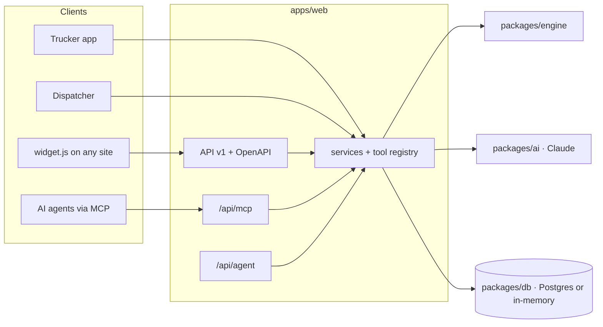

# Retorno · Don't drive home empty

**English** · [Español](README.es.md)

A return-load copilot for owner-operator truckers in Mexico. Tell it where and when you unload, what you pull and where
your base is, and it recommends the best load back (or a chain of two). It shows how much more you make than driving
home empty, explains why in plain trucker Spanish, and gives you a WhatsApp message ready to send.

> **Unofficial concept by Neftalí Hernández. Not affiliated with BeGo.** All data is synthetic. Cost defaults (diesel,
> fuel efficiency, tolls) are configurable assumptions, not market data.


---

## Why

Empty return trips are the core problem of a freight marketplace. BeGo's YC company profile says trucks run empty
around 40% of the time and that BeGo uses machine learning to reduce empty returns. Retorno explores that problem
end to end: a scoring engine, the trucker UX, a dispatcher view, and two ways to plug the engine into an existing
product (an embeddable widget and an MCP server for AI assistants).

## What's inside

| Surface                        | Route                            | For whom                                                                                                                                |
| ------------------------------ | -------------------------------- | --------------------------------------------------------------------------------------------------------------------------------------- |
| **Trucker app** (mobile-first) | `/` → `/cargas` → `/cargas/[id]` | Free text or voice → top 5 return loads, 2-load chains, detail with animated map, money waterfall, AI explanation, "Accept on WhatsApp" |
| **Dispatcher view**            | `/despacho`                      | Fleet map and "Simulate week": the same fleet and market under today's behavior vs. following recommendations, with live KPIs           |
| **Embeddable widget**          | `/embed` · `/widget.js`          | `<retorno-widget>`, a 5 KB (gzip) web component that works in HTML, React or Angular                                                    |
| **AI agent + MCP server**      | `/agent` · `/api/mcp`            | The engine as tools for an AI assistant: an in-app chat plus a standard MCP endpoint any agent can call                                 |
| **Public API**                 | `/api/v1/*` · `/docs`            | Versioned REST API with an OpenAPI 3.1 spec generated from the same Zod schemas that validate requests                                  |

Simulated week on the synthetic market (25 trucks, 320 loads, 7 days): empty km go from **34.4% to 22.1%**, and fleet
net profit increases by **+$668,543 MXN** (90 → 121 loads delivered). This illustrates the method, not real-world
results.

## How the recommendation works

The engine (`packages/engine`) is a set of pure functions: no database, network or clock. All of it is unit-tested,
including property-based tests.

**Distance.** Great-circle (haversine) distance × a road factor of 1.25. It is cheap and good enough to rank options
between ~20 cities. Its limit: one factor ignores mountains, coastlines and missing roads. A routing engine (OSRM) is
the next step.

**Money** (MXN, per load):

```
net profit     = rate − deadhead fuel − loaded fuel − tolls − maintenance
gain vs. empty = net profit − (cost to drive home empty after delivery) + (cost to drive home empty right now)
```

`gain vs. empty` is the headline number: how much better this load is than the default decision of going home empty.

**Ranking:**

```
score per hour = (net profit + home bonus − deadhead penalty − wait penalty) / total hours
home bonus     = w_home × (empty-return cost now − empty-return cost after delivery)
```

The weights (`w_home` and the two penalties) are what a feedback model would learn. Every accept/reject is already
logged with its features in `recommendation_events`.

**Hard filters** (a load failing any of them is never shown):

- compatible unit (a reefer can haul dry freight, not the other way around);
- pickup within 450 km of empty driving;
- the truck can arrive before the pickup window closes;
- the load must beat driving home empty.

When nothing qualifies, the UI explains why using the per-reason rejection counts.

**2-load chains.** A bounded beam search: the top 20 first legs, then the top 20 second legs from each destination,
so at most 400 combinations instead of every pair.

**Week simulation.** It runs each truck through the same market twice:

- _Today_: search only within 80 km of where you are, wait up to 6 h away from base, otherwise drive home empty.
- _With Retorno_: take the best recommendation that beats going home.

At the end every truck drives home, and that trip counts.

**Default assumptions** (all overridable per request through the API):

| Diesel | Fuel efficiency             | Tolls   | Maintenance | Road factor | Speed   | Loading + unloading | Max deadhead |
| ------ | --------------------------- | ------- | ----------- | ----------- | ------- | ------------------- | ------------ |
| $26/L  | 2.4 km/L loaded · 3.0 empty | $4.5/km | $2/km       | 1.25        | 60 km/h | 3 h                 | 450 km       |

## Where AI is used (and where it isn't)

**AI interprets and explains. Code computes every number.**

- **Parsing free text and voice** (`"descargo en Laredo mañana a las 10, traigo caja seca, mi base es Querétaro"`).
  - Claude uses structured outputs, a JSON Schema derived from Zod, and city ids are a closed enum.
  - The output is validated again in code.
  - If something is missing, the code (not the model) asks a follow-up question.
- **One-sentence explanations** ("Te conviene porque…").
  - Claude only receives facts that were already computed and formatted.
  - Any sentence containing a number that is not in those facts is rejected and replaced by a template.
- **Agent.** Claude chooses which engine tool to call. Tool outputs use local (Mexico City) timestamps, because models
  misread UTC as local time.

**The demo never breaks.** Missing key, timeout, rate limit, invalid output or provider errors all fall back to a
deterministic rule-based parser and templates. The fallback reason is tracked. AI calls are cached and rate-limited
per client.

## Architecture

pnpm + Turborepo monorepo:

```
apps/web          Next.js 16 (App Router): UI, API v1, /docs, /api/mcp, /api/agent, /embed, /agent
packages/engine   Pure engine: distance, costs, score, filters, chains, week simulation
packages/ai       Trip parsing, explanations, tool-use agent loop, plus deterministic fallbacks
packages/db       Drizzle schema, deterministic seed, Postgres and in-memory data sources
packages/widget   <retorno-widget> web component (esbuild → a single widget.js)
```



Design choices worth noting:

- **One tool registry** (`apps/web/src/server/tools.ts`) backs both the MCP server and the in-app agent, so they
  can't drift apart.
- **Zod everywhere.** The same schemas validate requests, generate the OpenAPI spec and parse responses in contract
  tests.
- **Data rebasing.** The seed is generated against a fixed date and shifted by whole days to "today" when read. The
  demo never goes stale and stays deterministic.
- **Fallbacks at every boundary.** Postgres falls back to the in-memory seed, Claude falls back to rules, WebGL falls
  back to a message.

## Integrate it

**Widget.** One script tag in any stack:

```html
<script src="https://YOUR-DEPLOYMENT/widget.js" defer></script>
<retorno-widget
  position="nuevo-laredo"
  base="queretaro"
  unit-type="dry_van_53"
  explain
></retorno-widget>
<script>
  document.querySelector("retorno-widget").addEventListener("retorno-accept", (event) => {
    console.log("Accepted", event.detail.recommendation.load.id);
  });
</script>
```

- **Shadow DOM**: it inherits the host font and doesn't leak styles. Theme it with `--retorno-*` CSS variables and
  `::part()`.
- **Events**: `retorno-load`, `retorno-accept` (cancelable), `retorno-reject`, `retorno-error`. They use hyphens
  because Angular's `(target:event)` syntax reserves the colon.
- **Cross-origin**: it calls the API of the origin that served `widget.js`, so it works on other domains out of the box.
- **Examples**: React and Angular snippets live at `/embed`.

**MCP server.** Stateless Streamable HTTP at `/api/mcp` with four read-only tools:

- `find_return_loads`
- `plan_load_chain`
- `explain_recommendation`
- `get_fleet_empty_km`

```json
{
  "mcpServers": {
    "retorno": { "command": "npx", "args": ["-y", "mcp-remote", "https://YOUR-DEPLOYMENT/api/mcp"] }
  }
}
```

You can also test it with `npx @modelcontextprotocol/inspector` (transport: Streamable HTTP).

**REST API.** Interactive docs at `/docs`. Main endpoints:

| Method     | Endpoint                  |
| ---------- | ------------------------- |
| POST       | `/api/v1/recommendations` |
| POST       | `/api/v1/chains`          |
| POST       | `/api/v1/parse-trip`      |
| POST · GET | `/api/v1/events`          |
| GET        | `/api/v1/cities`          |
| GET        | `/api/v1/fleet`           |
| GET        | `/api/v1/simulation`      |
| GET        | `/api/v1/health`          |

The API includes:

- a uniform error envelope with field-level details;
- CORS for the widget;
- a per-client rate limit on AI-backed requests;
- a 64 KB body limit.

## Quality

- **162 unit and integration tests** (Vitest):
  - engine, including property-based tests with fast-check;
  - AI with a fake client;
  - Postgres/in-memory parity;
  - API contract tests against the published schemas;
  - the MCP protocol through the official SDK client;
  - the widget in a simulated DOM.
- **64 E2E tests** (Playwright) on a production build:
  - viewports: mobile (375 px) and desktop;
  - flows: trucker, dispatcher, widget (including cross-origin), agent and public API;
  - every page: an **axe-core WCAG 2.1 AA scan in light and dark mode** and a horizontal-overflow check;
  - any console error fails the test.
- **CI** (GitHub Actions):
  - format, lint, typecheck, tests and build;
  - a separate E2E job that uploads the report on failure.

## Run it locally

Requirements: Node 22+, pnpm 10, and Docker (optional, for Postgres).

```bash
pnpm install
pnpm dev                      # http://localhost:3100. Works with zero config (in-memory data, no AI)
```

Optional services:

```bash
cp apps/web/.env.example apps/web/.env.local   # then fill in what you want
pnpm db:up && pnpm db:migrate && pnpm db:seed  # local Postgres in Docker (port 54329)
pnpm ai:smoke                                  # check the Claude integration end to end
```

| Variable                | Default                 | Without it                                                                             |
| ----------------------- | ----------------------- | -------------------------------------------------------------------------------------- |
| `ANTHROPIC_API_KEY`     | (none)                  | Rule-based parser and template explanations                                            |
| `ANTHROPIC_MODEL`       | `claude-haiku-5-5`      |                                                                                        |
| `DATABASE_URL`          | (none)                  | Deterministic in-memory seed. A Neon URL automatically uses the serverless HTTP driver |
| `RATE_LIMIT_PER_MINUTE` | `20`                    | AI-backed requests per client per minute                                               |
| `NEXT_PUBLIC_APP_URL`   | `http://localhost:3100` | Used in integration snippets                                                           |

```bash
pnpm check     # format + lint + typecheck + tests + build
pnpm e2e       # Playwright (builds and serves on :3200 in deterministic mode)
```

## Limitations and next steps

- **Real routing.** Replace haversine × 1.25 with OSRM, including tolls per route.
- **Learning the weights.**
  - Today: accept/reject events are logged with features, but the weights are hand-set defaults.
  - Next: a small logistic-regression service (Python/FastAPI) that fits `w_home` and the penalties.
  - It isn't built yet, and the app doesn't pretend it is.
- **Live data.** Real market loads, traffic, and truck positions from telematics.
- **Product.** Accounts and auth, real booking instead of a WhatsApp hand-off, Carta Porte, payments.
- **Deploy.** Vercel + Neon. The code is ready for it (stateless MCP, Neon HTTP driver, no in-memory sessions).

---

Built by **Neftalí Hernández**, Full Stack.
